<div align="center">
  
  <br>
  <sub>Received 22 January 2021 · Revised most days · Preprint, under continuous deployment</sub>
  <br>
  <sub>This header is LaTeX, and it compiles: <a href="paper/main.tex"><code>paper/main.tex</code></a></sub>
  <br><br>
  <a href="https://letx.app/open?repo=shihabshahrier/shihabshahrier&amp;path=paper"></a>
</div>

# Shihab Shahriar Antor

**AI engineer and founder of [Shahriar Labs](https://shahriarlabs.com/), an independent AI and software lab in Dhaka, Bangladesh.** I build [LetX](https://letx.app/), a real-time collaborative LaTeX editor with <!--letx:users-->12,800+<!--/letx:users--> registered users at <!--letx:institutions-->800+<!--/letx:institutions--> universities and research labs in <!--letx:countries-->80+<!--/letx:countries--> countries[^letx], and [offSchool](https://offschool.site/), simulation-first science learning for school students in Bangladesh. I am now building callgate, a gate that checks, approves and records every tool call an AI agent makes. I also publish open-source tools for AI coding agents, including [freelm](https://github.com/shihabshahrier/freelm), a free LLM API client for Python and Node.js.

I design systems end to end and ship the products I design: Go and Python backends, TypeScript and React applications, AI agents, retrieval, and the cloud infrastructure under them.

## 1. Products

<p align="center">
  
  
  
</p>
<p align="center"><sub><b>Fig. 1.</b> LetX: two authors, one source, one PDF. &nbsp; <b>Fig. 2.</b> offSchool: predict, run, learn. &nbsp; <b>Fig. 3.</b> callgate: allow, ask, deny, and write it all down.</sub></p>

| Product | What it is | Status | Where |
|:--|:--|:--|:--|
| **[LetX](https://letx.app/)** | Real-time collaborative LaTeX editor in the browser, an Overleaf alternative. Cloud compilation on full TeX Live, <!--letx:templates-->1,000+<!--/letx:templates--> templates, unlimited collaborators, Lexi (an AI LaTeX agent that reads the real compile log) and a hosted MCP server for Claude and ChatGPT. | Live | [letx.app](https://letx.app/) · [templates](https://letx.app/templates/) · [Lexi](https://letx.app/lexi/) · [MCP](https://letx.app/mcp/) · [live statistics](https://letx.app/stats/) |
| **[offSchool](https://offschool.site/)** | Simulation-first learning for class 9 and 10 (SSC) students in Bangladesh, on the NCTB syllabus, in Bangla and English. A student predicts the answer, runs a simulation, then learns the idea. | Live | [offschool.site](https://offschool.site/) |
| **callgate** | A model-neutral MCP proxy and library, written in Rust. An AI agent writes one script that calls many MCP tools, and callgate checks every call against policy, asks for approval where it must, keeps credentials out of the sandbox and journals the run. | In development (pre-alpha) | Repository is private for now |
| **[Context Heavy](https://shahriarlabs.com/products/context-heavy/)** | Persistent memory for AI agents: a multi-tenant knowledge graph with hybrid vector, text and graph retrieval. | Research system | [lab notes](https://shahriarlabs.com/products/context-heavy/) · [benchmark](https://github.com/shihabshahrier/CH-Bench) |
| **[Bagh](https://shahriarlabs.com/products/bagh-language/)** | A Bengali-first programming language with a browser IDE. | Active lab project | [lab notes](https://shahriarlabs.com/products/bagh-language/) · [try it](https://bagh-beta.shahriarlabs.com/) · [source](https://github.com/shihabshahrier/bagh-online) |

LetX is listed in Claude's connector directory and in ChatGPT's plugin directory. Shahriar Labs is a member of NVIDIA Inception, and LetX is supported by the Google for Startups Cloud Program, AWS Activate and Anthropic's Claude Startups program.

## 2. Open source

| Repository | What it does | Start |
|:--|:--|:--|
| **[freelm](https://github.com/shihabshahrier/freelm)** | Free LLM API for Python and Node.js. One OpenAI-compatible client, or a local endpoint, over the free tiers of Gemini, Groq, OpenRouter, Cloudflare Workers AI, Mistral, NVIDIA NIM and more, with automatic failover. MIT.[^freelm] | `pip install freelm` · `npm install freelm` |
| **[letx-plugin](https://github.com/Shahriar-Labs/letx-plugin)** | The LetX plugin for Claude and ChatGPT: the LetX MCP server (find a template, edit a project, compile to PDF) and two skills. | `claude plugin install letx@anthropic-plugin-directory` |
| **[latex-templates](https://github.com/Shahriar-Labs/latex-templates)** | Free, MIT-licensed, compile-tested LaTeX templates: theses, journal articles, CVs, grant proposals, posters and slides. | [browse](https://github.com/Shahriar-Labs/latex-templates) |
| **[softco](https://github.com/shihabshahrier/softco)** | An agent skill that makes a coding agent work like a software company: discovery, design, documentation, tests, code, infrastructure and deployment, in that order. MIT. | [read](https://github.com/shihabshahrier/softco#readme) |
| **[CH-Bench](https://github.com/shihabshahrier/CH-Bench)** | A benchmark for agent memory and RAG systems: retrieval, answer quality, latency and token cost, scored the same way for every system. Pure Python standard library. | [read](https://github.com/shihabshahrier/CH-Bench#readme) |
| **[wireguard-anywhere](https://github.com/shihabshahrier/wireguard-anywhere)** | Your own WireGuard VPN server on AWS, Google Cloud or Azure with one command, and one command to delete it. MIT. | [read](https://github.com/shihabshahrier/wireguard-anywhere#readme) |
| **[ChessGoddess](https://github.com/shihabshahrier/ChessGoddess)** | A chess analysis studio that turns Stockfish output into a readable review of a game. Go and React. | [read](https://github.com/shihabshahrier/ChessGoddess#readme) |

### Skills for AI coding agents

Small, installable skills for Claude Code and other coding agents. Each is one repository with one job.

| Skill | What the agent learns |
|:--|:--|
| [latex-engineer](https://github.com/shihabshahrier/latex-engineer) | Generate, compile and debug LaTeX projects |
| [manim-coding-skill](https://github.com/shihabshahrier/manim-coding-skill) | Teaching-quality STEM animations with ManimGL |
| [Godot-Skill](https://github.com/shihabshahrier/Godot-Skill) | GDScript 2.0 for Godot 4.3+, statically typed |
| [seo-master-skill](https://github.com/shihabshahrier/seo-master-skill) | SEO for search engines and AI answer engines |
| [skill-builder](https://github.com/shihabshahrier/skill-builder) | Build and audit agent skills from plain English |
| [common-knowledge](https://github.com/shihabshahrier/common-knowledge) | A Git-backed memory shared across projects and agents |
| [clean-my-mac](https://github.com/shihabshahrier/clean-my-mac) | Safe, staged macOS disk cleanup |
| [openrouter-free-infer](https://github.com/shihabshahrier/openrouter-free-infer) | Free models on OpenRouter from the command line |
| [claude-antigravity-orchestrator](https://github.com/shihabshahrier/claude-antigravity-orchestrator) | Claude plans, the Antigravity CLI does the legwork |

## 3. Research

My undergraduate thesis at BRAC University (November 2024, co-authored) detects exoplanets and stars in direct-imaging data from the James Webb Space Telescope. It combines contrastive learning (ResNet18 and Siamese networks) with few-shot learning and YOLO, and reports 92.16% accuracy.[^thesis]

## 4. Questions people ask

**Who is Shihab Shahriar Antor?**
An AI engineer from Dhaka, Bangladesh, and the founder of Shahriar Labs. He builds LetX, a collaborative LaTeX editor, and offSchool, a science learning site for Bangladeshi school students, and is developing callgate, a control layer for the tool calls AI agents make.

**What is LetX?**
LetX is an online LaTeX editor where several people write the same document at once and compile it in the cloud. It is an alternative to Overleaf with a free plan and unlimited collaborators; paid plans are listed at [letx.app/pricing](https://letx.app/pricing/).

**What is Shahriar Labs?**
An independent AI and software lab in Dhaka. Its two live products are LetX and offSchool; its research work includes Context Heavy, a memory system for AI agents, and Bagh, a Bengali-first programming language. It lives at [shahriarlabs.com](https://shahriarlabs.com/).

**How do I work with him?**
Write to [shihab@shahriarlabs.com](mailto:shihab@shahriarlabs.com), or start at [shihub.site/hire](https://shihub.site/hire).

## 5. Elsewhere

[shihub.site](https://shihub.site/) (portfolio and journal) · [Resume (PDF)](https://shihub.site/Shihab-Shahriar-Antor-Resume.pdf), or [open its LaTeX source in LetX](https://letx.app/open?repo=shihabshahrier/shihabshahrier&path=resume) · [Shahriar Labs](https://shahriarlabs.com/shihab-shahriar-antor/) · [LinkedIn](https://www.linkedin.com/in/shihabshahrier/) · [X](https://x.com/_shihabShahriar) · [shihab@shahriarlabs.com](mailto:shihab@shahriarlabs.com)

## Acknowledgements

To Reviewer 2, for the character. To TeX Live, for still compiling at three in the morning. To everyone who filed a bug instead of leaving.

**Competing interests.** The author founded the LaTeX editor he recommends.

## Cite

```bibtex
@misc{antor2026,
  author       = {Antor, Shihab Shahriar},
  title        = {AI Engineer and Founder, Shahriar Labs},
  howpublished = {\url{https://shihub.site/shihab-shahriar-antor}},
  address      = {Dhaka, Bangladesh},
  year         = {2026},
  note         = {LetX: \url{https://letx.app/}. offSchool: \url{https://offschool.site/}}
}
```

[^letx]: Counted by LetX itself and published at [letx.app/stats](https://letx.app/stats/). Universities and research labs are counted from verified academic email domains. Figures on this page were last read on <!--letx:date-->23 November 2026<!--/letx:date--> and are rounded down.
[^freelm]: Packages: [freelm on PyPI](https://pypi.org/project/freelm/) and [freelm on npm](https://www.npmjs.com/package/freelm). Documentation: [shahriarlabs.com/products/freelm](https://shahriarlabs.com/products/freelm/).
[^thesis]: "Synergistic application of advanced machine learning and computer vision techniques for the detection of exoplanet and star: leveraging contrastive learning in astronomical imagery", BRAC University, 2024. Record: [hdl.handle.net/10361/25223](http://hdl.handle.net/10361/25223).
